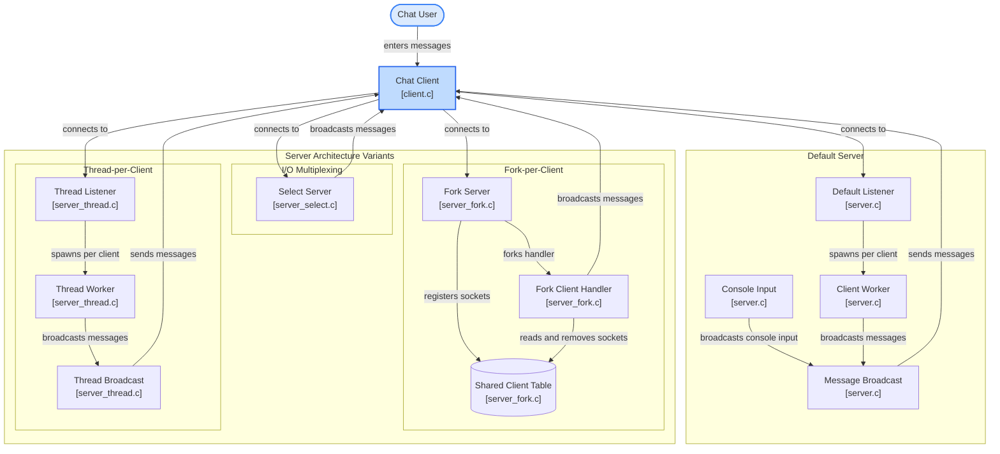

# Concurrent TCP Chat Server

A complete implementation and comparative study of concurrent TCP chat servers using **Berkeley Sockets**, covering:
1. **I/O Multiplexing (`select()`)** — `server_select.c`
2. **Thread-per-Client (`pthread` / Win32)** — `server_thread.c`
3. **Fork-per-Client (Multi-Process / POSIX)** — `server_fork.c`

Includes a cross-platform client (`client.c`) and an in-depth technical analysis report ([`COMPARISON.md`](COMPARISON.md)).

---

## System Architecture



---

## Project Structure

```
simple_tcp_chat/
├── server_select.c   # Approach 1: Single-threaded event loop using select()
├── server_thread.c   # Approach 2: Multi-threaded server using thread-per-client
├── server_fork.c     # Approach 3: Multi-process server using fork() + shared memory
├── server.c          # Dual-console interactive chat server (default)
├── client.c          # Cross-platform TCP chat client
├── COMPARISON.md     # In-depth architectural comparison and benchmark report
├── Makefile          # Build configuration for Linux / Ubuntu / WSL
└── README.md         # Documentation & execution instructions
```

Default Port: **9090**

---

## How to Compile and Run

### On Windows (PowerShell)

#### 1. Compile the Client:
```powershell
gcc -Wall -Wextra -std=c11 client.c -o client.exe -lws2_32
```

#### 2. Run Approach 1 — `select()` Server:
```powershell
gcc -Wall -Wextra -std=c11 server_select.c -o server_select.exe -lws2_32
.\server_select.exe
```

#### 3. Run Approach 2 — Thread-per-Client Server:
```powershell
gcc -Wall -Wextra -std=c11 server_thread.c -o server_thread.exe -lws2_32
.\server_thread.exe
```

#### 4. Run Clients (Open multiple terminal windows):
```powershell
.\client.exe 127.0.0.1 9090
```

---

### On Linux / Ubuntu / WSL (bash)

You can build all targets at once using the Makefile:
```bash
make
```

Or compile individual targets manually:

#### Approach 1 — `select()` Server:
```bash
gcc -Wall -Wextra -std=c11 server_select.c -o server_select
./server_select
```

#### Approach 2 — Thread-per-Client Server:
```bash
gcc -Wall -Wextra -std=c11 server_thread.c -o server_thread -lpthread
./server_thread
```

#### Approach 3 — Fork-per-Client Server:
```bash
gcc -Wall -Wextra -std=c11 server_fork.c -o server_fork
./server_fork
```

#### Client:
```bash
gcc -Wall -Wextra -std=c11 client.c -o client -lpthread
./client 127.0.0.1 9090
```

---

## Architectural Comparison Summary

| Metric | `fork()` per Client | Thread per Client | `select()` / `poll()` |
| :--- | :--- | :--- | :--- |
| **Model** | Multi-Process | Multi-Threaded | Event-Driven (Single Thread) |
| **Memory Overhead** | High (process table + CoW) | Moderate (thread stack) | Lowest (zero extra threads) |
| **Context Switch Cost** | Heavy (TLB/cache flush) | Lightweight | None (single event loop) |
| **State Sharing / Broadcast** | Complex (Requires IPC) | Easy (Shared heap + Mutex) | Trivial (Same memory, lock-free) |
| **Fault Isolation** | **High** (crash is isolated) | **Low** (crashes whole server)| **Low** (crashes whole server) |
| **Platform Portability** | POSIX only (Linux/WSL) | Cross-platform | Cross-platform |

For full details, graphs, and the C10K problem analysis, read [**COMPARISON.md**](COMPARISON.md).
